# Post-contenido U6: Instrucciones y Direccionamiento (NASM sobre DOSBox)

**Asignatura:** Arquitectura de Computadores, Unidad 6, Post-contenido

**Estudiante:** Diego Alferez

**Repositorio:** `Alferez-post1-u6`

## Entorno de trabajo

| Elemento | Detalle |
|---|---|
| Emulador | DOSBox 0.74-3 (3000 ciclos), carpeta del repositorio montada como `C:` |
| Ensamblador | NASM 2.15.05 (`nasm -f bin`, formato `.COM`, `org 100h`) |
| Depurador | `DEBUG` (comandos `R`, `T`, `G`, `D`, `U`) |
| Editor | Visual Studio Code en Windows |

El estudiante montó la carpeta del repositorio con `MOUNT C "C:\Users\diego\OneDrive\Documentos\UFPS\Arquitectura de Computadores\Unidad 6\Alferez-post1-u6"` y verificó NASM con `nasm -v`.

**Nota sobre nombres de archivo.** DOSBox 0.74 solo maneja nombres 8.3, por lo que dentro de DOSBox los fuentes se ven como `LAB6_I~1.ASM` y `LAB6_M~1.ASM`. El estudiante compiló con esos nombres cortos y generó `lab6_i.com` y `lab6_m.com`; después los renombró en Windows a `lab6_instrucciones.com` y `lab6_modos.com`, que son los nombres entregados.

## Estructura del repositorio

| Archivo | Contenido |
|---|---|
| `lab6_instrucciones.asm` / `.com` | Parte 1: instrucciones mixtas (Bloques 1 a 5 y variante factorial) |
| `lab6_modos.asm` / `.com` | Parte 2: modos de direccionamiento (inmediato, directo, indirecto, indexado, marco BP y matriz 3x3) |
| `capturas/` | Capturas de la compilación y de las sesiones de DEBUG |
| `README.md` | Este documento |

En un programa `.COM` el código y los datos comparten un único segmento. Todos los desplazamientos de este documento (por ejemplo `0102h`) incluyen el origen `100h` y coinciden con lo que muestra DEBUG.

---

# Parte 1: Programa de instrucciones mixtas (`lab6_instrucciones.asm`)

El programa salta sobre los datos con `jmp inicio`, ejecuta cinco bloques en secuencia y termina con `INT 20h`.

## Checkpoint 1: compilación exitosa

El estudiante ejecutó `nasm -f bin LAB6_I~1.ASM -o lab6_i.com` y NASM terminó sin errores ni advertencias.

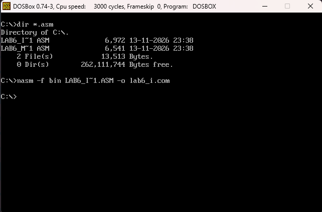

## Descripción de los bloques

### Bloque 1: transferencia de datos

El bloque usa `MOV` (memoria a registro y registro a registro), `LEA` para obtener la dirección de `valor_a` (no su contenido), `XCHG` para intercambiar `CX` y `DX` dos veces (queda como al inicio) y `PUSH`/`POP` para preservar `AX` mientras se modifica temporalmente.

| Instrucción | Registro modificado | Valor resultante |
|---|---|---|
| `mov ax, [valor_a]` | AX | 002Dh (45) |
| `mov bx, [valor_b]` | BX | 000Ch (12) |
| `mov cx, ax` / `mov dx, bx` | CX / DX | 002Dh / 000Ch |
| `lea si, [valor_a]` | SI | 0102h (dirección, no valor) |
| `mov ax, [si]` | AX | 002Dh (45, acceso indirecto) |
| `xchg cx, dx` | CX / DX | 000Ch / 002Dh |
| `xchg cx, dx` | CX / DX | 002Dh / 000Ch (restaurados) |
| `push ax`, `mov ax, 0FFFFh`, `pop ax` | AX, SP | AX vuelve a 002Dh; SP baja 2 bytes y se recupera |

### Bloque 2: operaciones aritméticas

| Instrucción | Resultado | Flags observados (OF ZF SF CF) |
|---|---|---|
| `add ax, [valor_b]` | AX = 0039h (57) | NV NZ PL NC (OF=0, ZF=0, SF=0, CF=0) |
| `sub ax, [valor_a]` | AX = FFDFh (-33) | NV NZ NG CY (OF=0, ZF=0, SF=1, CF=1) |
| `inc ax` / `dec ax` | AX = 002Eh / 002Dh | CF no cambia (conserva el CY del `sub`) |
| `mul bl` (AL=10, BL=7) | AX = 0046h (70) | CF=0 |
| `div bl` (AX=100, BL=7) | AL = 0Eh (14), AH = 02h (2) | indefinidos tras DIV |

El resultado de la suma (57) se guarda en la variable `resultado`.

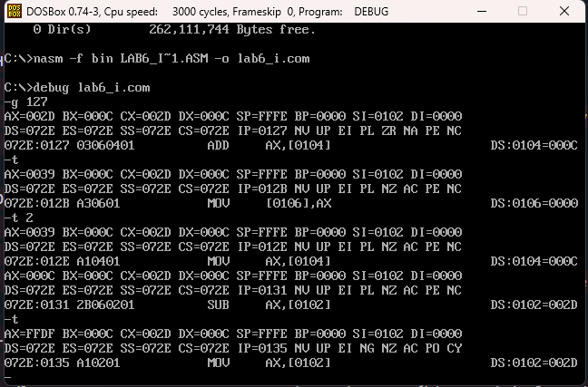

### Bloque 3: operaciones lógicas

| Instrucción | Resultado | Flags observados |
|---|---|---|
| `and al, [mascara]` (AL=B7h) | AL = 07h (conserva 4 bits bajos) | NV NZ PL NC |
| `or al, 0F0h` (AL=B7h) | AL = F7h (activa 4 bits altos) | NV NZ NG NC |
| `xor al, 0FFh` (AL=AAh) | AL = 55h (inversión) | NV NZ PL NC |
| `xor bx, bx` | BX = 0000h | NV ZR PL NC (ZF=1) |
| `test al, 01h` (AL=B7h) | AL sigue en B7h | NV NZ PL NC (ZF=0, bit 0 en 1: impar) |
| `shl al, 2` (AL=08h) | AL = 20h (x4) | |
| `shr al, 1` | AL = 10h (/2) | |

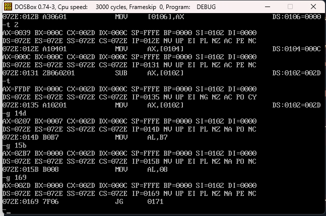

### Bloque 4: control de flujo

El programa compara `valor_a` con `valor_b` usando `cmp ax, [valor_b]`: 45 - 12 = 33 > 0, de modo que `jg .mayor` salta y deja `CX = 1`. Los flags del `cmp` son NV NZ PL NC. Después un bucle con `LOOP` suma 1+2+3+4+5. `CX` arranca en 5 y llega a 0 al terminar; `BX` termina en 6.

| Iteración | AX tras `add ax, bx` | BX tras `inc bx` | CX tras `loop` |
|---|---|---|---|
| 1 | 0001h | 0002h | 0004h |
| 2 | 0003h | 0003h | 0003h |
| 3 | 0006h | 0004h | 0002h |
| 4 | 000Ah | 0005h | 0001h |
| 5 | 000Fh (15) | 0006h | 0000h |

**Resultado:** `AX = 000Fh = 15`, como se esperaba.

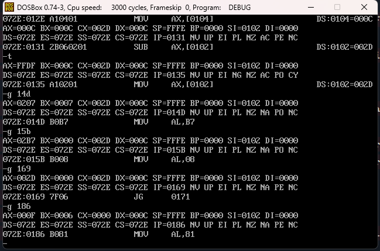

### Bloque 5: rotación (ROL/ROR) frente a desplazamiento (SHL/SHR)

El valor de entrada es `AL = 81h = 1000 0001b`, con el bit 7 y el bit 0 en 1.

| Instrucción | Registro | Valor final | CF |
|---|---|---|---|
| `shl bl, 1` | BL | 02h (el bit 7 se pierde) | 1 |
| `rol cl, 1` | CL | 03h (el bit 7 reaparece como bit 0) | 1 |
| `shr dl, 1` | DL | 40h (el bit 0 se pierde) | 1 |
| `ror bh, 1` | BH | C0h (el bit 0 reaparece como bit 7) | 1 |
| `rol al, 4` (AL=A5h) | AL | 5Ah (nibbles intercambiados) | 0 |

Tras las cuatro primeras instrucciones DEBUG muestra `BX=C002`, `CX=0003`, `DX=0040` y, tras `rol al, 4`, `AL=5A`. En el último `rol al, 4` el último bit rotado es 0, por eso CF queda en 0.

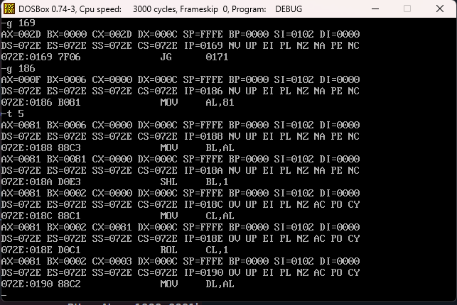

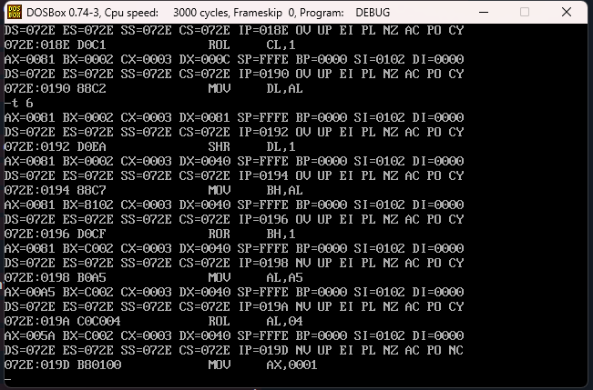

### Variante factorial (Checkpoint 3)

El estudiante agregó, como commit separado, un bucle que calcula 5! reemplazando `ADD` por `MUL`: arranca con `AX=1`, `CX=5`, `BX=1` y en cada vuelta ejecuta `mul bx` (DX:AX = AX * BX), `inc bx` y `loop`. El bucle de suma se conserva para poder verificar ambos resultados.

| Iteración | AX tras `mul bx` | BX tras `inc bx` |
|---|---|---|
| 1 | 0001h | 0002h |
| 2 | 0002h | 0003h |
| 3 | 0006h | 0004h |
| 4 | 0018h (24) | 0005h |
| 5 | 0078h (120) | 0006h |

**Resultado:** `AX = 0078h = 120 = 5!`.

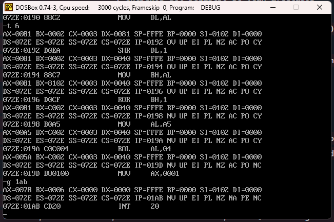

---

# Parte 2: Modos de direccionamiento (`lab6_modos.asm`)

El programa define en memoria un array de cinco enteros, un registro de tres campos (`nota1`, `nota2`, `promedio`), una variable `var_x`, una tabla de dígitos hexadecimales y una matriz 3x3, y accede a esos datos con modos de direccionamiento distintos.

Mapa de datos (desplazamientos dentro del segmento, con `org 100h`):

| Símbolo | Dirección | Contenido |
|---|---|---|
| `array` | 0102h | 10, 20, 30, 40, 50 |
| `nota1` | 010Ch | 85 |
| `nota2` | 010Eh | 73 |
| `promedio` | 0110h | 0 (luego 79) |
| `var_x` | 0112h | FFFFh |
| `tabla_hex` | 0114h | 16 bytes ASCII |
| `matriz` | 0124h | 1..9 (9 palabras) |

## Checkpoint 1: estructura en memoria

El estudiante compiló con `nasm -f bin LAB6_M~1.ASM -o lab6_m.com`, abrió el `.COM` con DEBUG y ejecutó `D 100 13F`. En el volcado se identifican, en little-endian, los valores del array (`0A00 1400 1E00 2800 3200` = 10, 20, 30, 40, 50), `nota1` (`5500` = 85) y `nota2` (`4900` = 73).

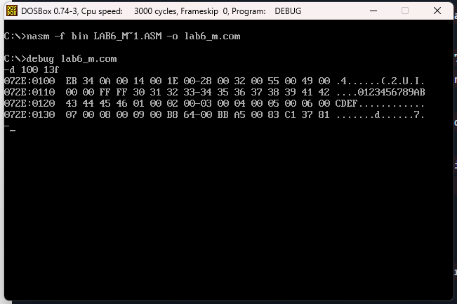

## Modo 1: inmediato

El operando va dentro del opcode, sin acceso a memoria de datos: `mov ax, 100` (AX = 0064h), `mov bx, 0A5h` (BX = 00A5h), `add cx, 55` y `and dx, 00FFh`. Con `U 100` el valor `0064` se ve en la propia instrucción desensamblada.

## Modo 2: directo

La dirección efectiva está fija en la instrucción: `mov ax, [var_x]` (AX = FFFFh, EA = 0112h), `mov bx, [array]` (BX = 000Ah, EA = 0102h), `mov cx, [nota1]` (CX = 0055h, EA = 010Ch) y `mov [var_x], word 0`, que escribe 0 en memoria.

## Modo 3: indirecto por registro (Checkpoint 2)

El registro contiene la dirección del operando. El estudiante trazó el bloque con `T` y registró cada cambio:

| Instrucción | Registro modificado | Valor resultante |
|---|---|---|
| `mov si, nota1` | SI (antes 0000h) | 010Ch (dirección de `nota1`) |
| `mov ax, [si]` | AX | 0055h (85) |
| `mov si, nota2` | SI | 010Eh (dirección de `nota2`) |
| `mov bx, [si]` | BX | 0049h (73) |
| `add ax, bx` | AX | 009Eh (158) |
| `shr ax, 1` | AX | 004Fh (79) |
| `mov si, promedio` | SI | 0110h (dirección de `promedio`) |
| `mov [si], ax` | mem[0110h] | 004Fh (79 guardado por el puntero) |

AX = 0055h confirma que el valor leído por `[si]` es 85.

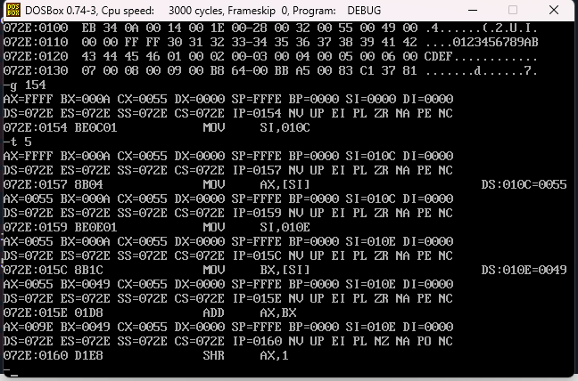

## Modo 4: indexado (Checkpoint 3)

La dirección efectiva es base + índice (+ desplazamiento). `mov bx, array` / `mov si, 4` / `mov ax, [bx + si]` lee `array[2]`: EA = 0102h + 0004h = 0106h y AX = 001Eh (30). Luego un bucle con `[bx + si]` suma los cinco elementos avanzando `SI` de 2 en 2.

| Iteración | SI antes | AX tras `add ax, [bx + si]` |
|---|---|---|
| 1 | 0000h | 000Ah |
| 2 | 0002h | 001Eh |
| 3 | 0004h | 003Ch |
| 4 | 0006h | 0064h |
| 5 | 0008h | 0096h (150) |

**Resultado:** `AX = 0096h = 150`.

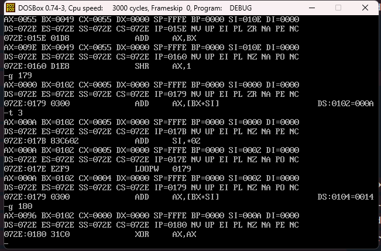

**Extensión (recorrido inverso).** El estudiante agregó un segundo bucle que parte de `SI = 8` (`array[4]`) y retrocede con `sub si, 2`. Las sumas parciales son 0032h, 005Ah, 0078h, 008Ch y 0096h, de modo que también termina con **AX = 0096h = 150**.

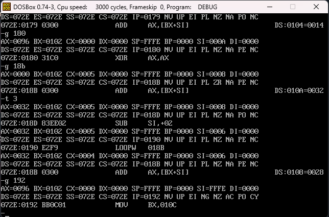

Acceso a los campos del registro con desplazamiento fijo: `mov bx, nota1` (BX = 010Ch), `mov ax, [bx]` (AX = 0055h), `mov cx, [bx + 2]` (CX = 0049h) y `mov dx, [bx + 4]` (DX = 004Fh).

## Modo 3b: indirecto por BP, marco de pila (Checkpoint 4)

BP se usa como base de un marco de variables locales. Tras `push bp` y `mov bp, sp`, BP y SP valen lo mismo; luego `sub sp, 4` reserva dos palabras.

| Instrucción | SP | BP | Observación |
|---|---|---|---|
| (antes de `push bp`) | FFFEh | 0000h | estado inicial en DEBUG |
| `push bp` | FFFCh | 0000h | guarda el BP del programa principal |
| `mov bp, sp` | FFFCh | FFFCh | BP = SP |
| `sub sp, 4` | FFF8h | FFFCh | reserva 4 bytes |
| `mov word [bp - 2], 99` | FFF8h | FFFCh | escribe en SS:FFFAh |
| `mov word [bp - 4], 250` | FFF8h | FFFCh | escribe en SS:FFF8h |
| `mov ax, [bp - 2]` / `add ax, [bp - 4]` | FFF8h | FFFCh | AX = 0063h y luego **015Dh (349)** |
| `mov sp, bp` | FFFCh | FFFCh | libera las locales |
| `pop bp` | FFFEh | 0000h | BP recupera su valor original |

El volcado `D SS:FFF8 FFFF` muestra `FA 00` en SS:BP-4 (250) y `63 00` en SS:BP-2 (99), ambos en little-endian.

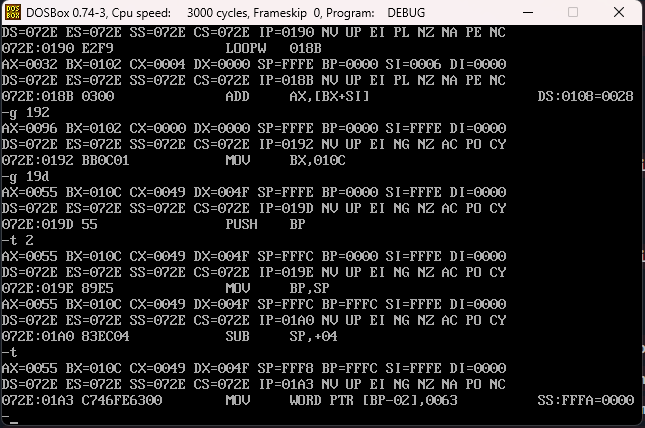

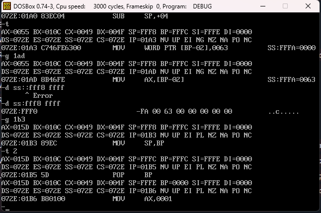

## Acceso a matriz 3x3 con doble indexación (Checkpoint 5)

Para `matriz[1][2]` la dirección efectiva es `base + fila * ancho_fila * 2 + columna * 2`.

| Instrucción | Registro modificado | Valor resultante |
|---|---|---|
| `mov ax, 1` / `mov bx, 3` | AX / BX | 0001h / 0003h |
| `mul bx` | AX | 0003h (fila x ancho, en elementos) |
| `shl ax, 1` | AX | 0006h (desplazamiento de fila en bytes) |
| `mov si, ax` | SI | 0006h |
| `mov cx, 2` / `shl cx, 1` | CX | 0004h (desplazamiento de columna en bytes) |
| `add si, cx` | SI | **000Ah (10)** |
| `mov bx, matriz` | BX | 0124h |
| `mov dx, [bx + si]` | DX | **0006h** (EA = 0124h + 000Ah = 012Eh) |

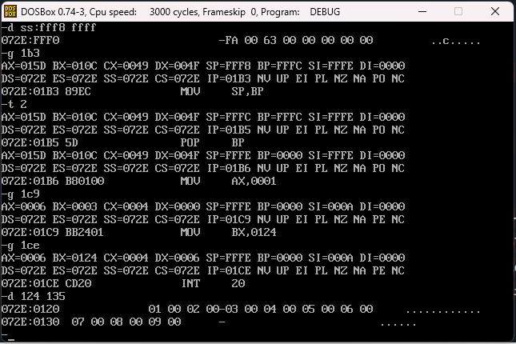

## Tabla resumen de los modos de direccionamiento

| Modo | Fórmula de la dirección efectiva | Instrucción NASM usada | Valor observado en DEBUG |
|---|---|---|---|
| Inmediato | no hay EA: el dato está en el opcode | `mov ax, 100` | AX = 0064h |
| Directo | EA = desplazamiento fijo | `mov ax, [var_x]` | EA = 0112h, AX = FFFFh |
| Indirecto por registro | EA = SI | `mov si, nota1` / `mov ax, [si]` | SI = 010Ch, AX = 0055h |
| Indirecto por BP (marco de pila) | EA = BP + desplazamiento, segmento SS | `mov ax, [bp - 2]` / `add ax, [bp - 4]` | BP = FFFCh, EA = FFFAh y FFF8h, AX = 015Dh |
| Indexado | EA = BX + SI | `mov ax, [bx + si]` | BX = 0102h, SI = 0004h, AX = 001Eh; suma del bucle AX = 0096h |
| Indexado con desplazamiento | EA = BX + desplazamiento | `mov cx, [bx + 2]` | BX = 010Ch, CX = 0049h |
| Doble indexación (matriz) | EA = base + fila*ancho*2 + columna*2 | `mov dx, [bx + si]` | BX = 0124h, SI = 000Ah, DX = 0006h |

---

# Decisiones técnicas

## Parte 1, decisión 1: ¿SHL/SHR o ROL/ROR?

La elección depende de si el bit que sale del registro debe descartarse o preservarse. SHL y SHR son la herramienta correcta para la aritmética: desplazar a la izquierda multiplica por una potencia de 2 y desplazar a la derecha divide, como en el Bloque 3 (`shl al, 2` convierte 8 en 32 y `shr al, 1` lo lleva a 16). En ese caso el bit que se pierde no aporta al resultado numérico, y el desplazamiento rellena con ceros. ROL y ROR son preferibles cuando ningún bit debe perderse: el intercambio de nibbles del Bloque 5 (`rol al, 4` convierte A5h en 5Ah), los checksums circulares o el cifrado por rotación. SHL nunca podría intercambiar los nibbles, sin importar cuántas veces se aplique ni si se combina con OR: al desplazar cuatro posiciones el nibble alto sale del registro y se pierde, el nibble bajo queda en cero y ya no existe información para reconstruir el resultado. Con AL = 81h, tras `shl al, 1` el bit 7 original (1) desaparece del registro y solo queda visible en CF (AL = 02h), mientras que tras `rol al, 1` ese mismo bit reaparece como el nuevo bit 0 (AL = 03h). Esa diferencia, descartar frente a preservar, es la que decide qué instrucción conviene.

## Parte 1, decisión 2: ¿LOOP o DEC/JNZ?

`LOOP` ofrece una ventaja clara de legibilidad y tamaño de código fuente: una sola instrucción de 2 bytes expresa "decrementar CX y repetir si CX es distinto de cero", mientras que `DEC CX` más `JNZ` son dos instrucciones y 3 bytes. Además, deja explícita la intención de que `CX` es el contador del bucle. Sin embargo, el número de instrucciones escritas no es un indicador confiable del tiempo de ejecución: cada instrucción tiene su propio costo de decodificación y ejecución, y en procesadores posteriores al 8086 original (486, Pentium y los modernos) `LOOP` se implementa de forma más lenta que la pareja `DEC`/`JNZ`, que además puede ejecutarse de forma segmentada o fusionada. Una instrucción compacta puede esconder varias micro-operaciones. Para el bucle de 5 iteraciones del Bloque 4, la diferencia es despreciable y ningún usuario la percibiría, así que conviene elegir la forma más legible. La respuesta cambia si el mismo bucle se ejecuta millones de veces dentro de un programa más grande: ahí la diferencia por iteración se acumula y `DEC`/`JNZ` pasa a ser la mejor opción, idealmente confirmada con una medición.

## Parte 2, decisión 1: ¿modo directo o indexado para un elemento de posición fija?

`matriz[1][2]` siempre está en la misma posición, conocida al ensamblar. El modo directo coloca la dirección efectiva dentro del opcode, de modo que una sola instrucción (`mov dx, [matriz + 10]`) lee el dato sin cálculos adicionales en tiempo de ejecución. El modo indexado del Paso 7, en cambio, paga en cada ejecución una `MUL` (una de las instrucciones más costosas en ciclos), dos `SHL`, un `ADD` y un `MOV` solo para construir una dirección que ya era constante. Por eso, para una posición fija, el directo es más eficiente en ciclos y más corto. El indexado se vuelve indispensable cuando la fila o la columna no se conocen al compilar y dependen de una variable calculada en tiempo de ejecución, por ejemplo el índice de un bucle que recorre filas y columnas, porque la dirección efectiva debe recalcularse en cada vuelta. Si hubiera que sumar las 9 posiciones, usar 9 etiquetas directas sería impráctico: el código crecería con el tamaño de la matriz y sería imposible para matrices de tamaño variable. Un solo bucle indexado resuelve cualquier tamaño con el mismo código.

## Parte 2, decisión 2: BP frente a BX/SI

La arquitectura x86 asigna a cada registro base un segmento por defecto: BX, SI y DI usan DS, mientras que BP usa SS. La convención reserva BP para el direccionamiento relativo a la pila (variables locales con desplazamientos negativos y parámetros con positivos), porque SP cambia con cada `PUSH` y `POP` y BP ofrece una referencia estable dentro del marco; BX, SI y DI quedan como punteros a datos. En este laboratorio, al ser un `.COM` con un único segmento, DS y SS coinciden y BP o BX producen el mismo resultado observable. En un `.EXE` con segmentos separados (DS distinto de SS) la diferencia sí es crítica: si el código asumiera que `[bp + desplazamiento]` apunta al segmento de datos igual que `[bx + desplazamiento]`, leería o escribiría en la pila, obteniendo valores incorrectos o, peor, sobrescribiendo direcciones de retorno y datos de otros marcos, sin que el procesador avise del error. Para forzar a una instrucción con BP a usar DS se emplea un prefijo de sobrescritura de segmento, por ejemplo `mov ax, [ds:bp + 2]`. Tiene sentido cuando faltan registros y se necesita recorrer una estructura de datos con BP como base, o cuando una rutina recibe un puntero a datos del segmento DS.

---

# Historial de commits

Los commits están ordenados por avance del laboratorio: bloques 1 a 4 de la Parte 1, Bloque 5 de rotación, variante factorial, modos 1 a 4 de la Parte 2, marco BP y matriz, recorrido inverso del array y documentación final. Cada commit incluye las capturas del checkpoint correspondiente.
